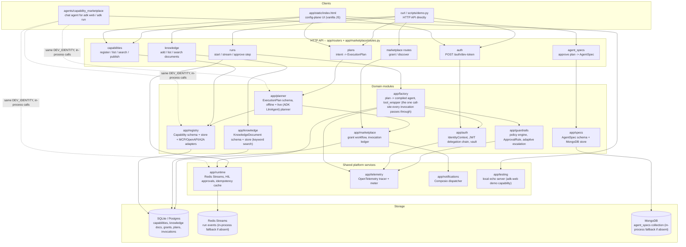

# Module-wise architecture

> **Superseded in parts by the production rebuild** -- MongoDB is gone (specs are
> in Postgres), and new layers were added (`app/core`, `app/sessions`, `app/memory`,
> `app/tenancy`). See [`docs/PRODUCTION_ARCHITECTURE.md`](docs/PRODUCTION_ARCHITECTURE.md)
> for the current architecture; this file describes the pre-rebuild module map.

This is the module-by-module map of what's actually in this repository --
companion to the fuller architecture write-up (the Claude Docs artifact this
project started from), but scoped to "what's a Python package here and what
talks to what," for anyone reading the code rather than the design doc.

## What each module is responsible for

| Module | Responsibility | Depends on | New in this round? |
|---|---|---|---|
| `app/auth` | `IdentityContext`, the platform→tenant→run→tool-call JWT delegation chain, the BYOK vault | `app/telemetry` | existing |
| `app/registry` | The unified `Capability` schema; MCP / OpenAPI / A2A adapters; save/search/discover, grant-gated vs. not | `app/db` | existing |
| `app/knowledge` | Per-tenant free-text documents an agent can be grounded against; keyword search today, the one seam embeddings plug into later | `app/db` | **new** -- the "where I add knowledge" part of the config plane |
| `app/planner` | Turns a natural-language intent into a typed `ExecutionPlan`, offline (deterministic) or live (ADK `LlmAgent` + `PlanReActPlanner`) | `app/registry`, `app/marketplace` | existing |
| `app/specs` | The declarative, versioned `AgentSpec` a plan graduates into once a human approves it; MongoDB-backed, falls back to an in-process store if Mongo isn't reachable | `app/planner` schemas | **new** -- the "chat → plan → approve → save" part of the config plane |
| `app/factory` | Compiles an `ExecutionPlan` into a running executor; `tool_wrapper.py` is the one call-site guardrails/auth/idempotency/telemetry all pass through | `app/guardrails`, `app/auth`, `app/runtime` | existing |
| `app/guardrails` | Data-driven `GuardrailPolicy`, dynamic `ApprovalRule`, adaptive escalation off repeated blocks | `app/telemetry` | existing |
| `app/marketplace` | Cross-tenant request/grant workflow, the per-invocation ledger | `app/db`, `app/notifications` | existing |
| `app/runtime` | Redis Streams (durable, resumable run events), human-in-the-loop approval store, idempotency cache | `app/config` | existing |
| `app/telemetry` | One `TracerProvider`/`MeterProvider`, console or OTLP export | `app/config` | existing |
| `app/notifications` | Composio dispatch on grant/run events | `app/config` | existing |
| `app/testing` | A local echo HTTP server backing the adk-web demo capability | -- | existing (prior round) |
| `app/routers` + `app/marketplace/routes.py` | The FastAPI endpoints -- thin, no business logic of their own | everything above | `knowledge.py` and `agent_specs.py` are **new**; `GET /capabilities` (list, no query) added to the existing router |
| `app/static/index.html` | The minimal configuration-plane UI: knowledge base, tool registration/search, and the chat → plan → approve → spec flow | the routers above, same-origin `fetch()` | **new** |
| `agents/capability_marketplace` | The `adk web` / `adk run` conversational orchestrator -- a different front door onto the same domain modules | `app/registry`, `app/planner`, `app/runtime` | existing (prior round) |

## Two front doors, one backend

The config-plane UI (`app/static/index.html`) and the `adk web` chat agent
(`agents/capability_marketplace/agent.py`) are two different clients of the
exact same domain modules and the exact same SQLite/Mongo data -- a
capability registered through one shows up in the other, and an
`AgentSpec` approved in the UI is the same MongoDB document whether it's
read back by the UI's "saved specs" list or a future automated consumer.
Neither one contains logic the other doesn't already share: both are thin
clients over `app/`.
