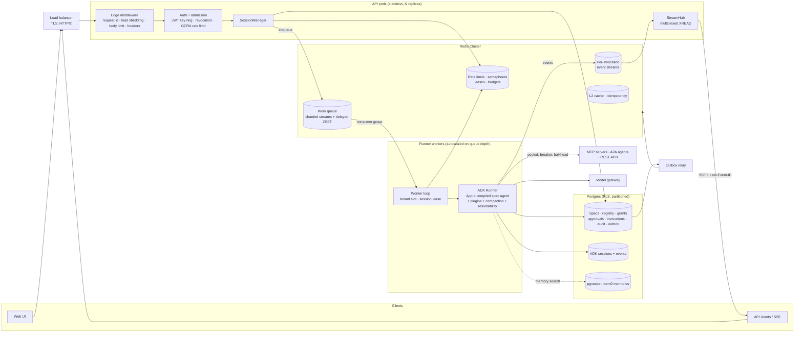
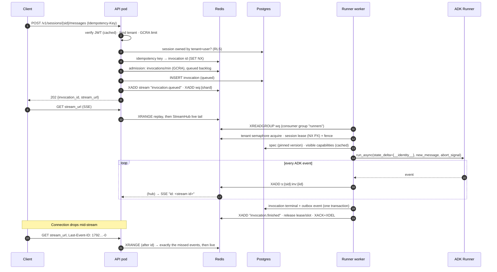

# Agent-as-Spec: Production Architecture

This document covers the production rebuild of the platform: what changed in each layer, why, and which techniques and design patterns make it horizontally scalable, multi-tenant and failure-tolerant. The target is a heavy multi-tenant system at around **100k requests/second**.

It covers:
- the new request path: API → session manager → work queue → runner workers → ADK Runner → resumable Redis streams;
- every module that changed;
- the security issues found and fixed;
- capacity math;
- operations;
- an honest list of what is and isn't proven yet.

---

## 1. The system at a glance



There are four **process roles**, built from one image:

| Role | Command | Scales on |
|---|---|---|
| `api` | `uvicorn app.main:app` | CPU, request rate |
| `runner` | `python -m app.sessions.runner` | work-queue depth per worker |
| `relay` | `python -m app.relay_main` | 2+ replicas for availability |
| `migrate` | `python -m app.core.migrate` | runs once per deploy (owner DB role) |

---

## 2. The request path: API → SessionManager → Runner → resumable stream



### 2.1 Why the stream survives losing the internet connection

Every event is appended to a Redis Stream with a server-assigned id (`<ms>-<seq>`, strictly increasing). That id is sent as the SSE `id:` line.

When the connection drops, the browser's `EventSource` reconnects by itself and sends `Last-Event-ID`; other clients can pass `?after=`. The API answers in two steps:
1. **XRANGE** from that id, which replays exactly the missed events;
2. a **live tail** through the StreamHub.

This works from any API replica, because the state lives in Redis rather than in the pod. There are no consumer groups on the read side, so any number of tabs or devices can follow one invocation with independent cursors.

- `retry: 2000` tells the client how fast to reconnect.
- `: ping` heartbeats every 15 s keep proxies from closing idle streams.
- Streams are capped with `MAXLEN ~` and expire 24 h after the last write.

The multi-process smoke test showed this end to end, with the API, runner and relay as separate OS processes on Postgres and Redis:
1. read 2 events;
2. drop the connection;
3. reconnect with `Last-Event-ID`;
4. receive the remaining 5 events.

The full stream equalled before + after, with no gap and no duplicate.

### 2.2 Why a runner crash doesn't lose or repeat work

| Failure | What happens |
|---|---|
| Worker dies mid-invocation | The job is never ACKed. Another worker `XAUTOCLAIM`s it after `runner_visibility_timeout_ms` and **resumes the same ADK invocation** from its last persisted event (resumable `App` plus the stored `adk_invocation_id`). |
| Same side-effecting tool call executed twice | Prevented. The idempotency key `(ADK invocation id, step, args)` returns the first result, and a short NX execution lock stops two workers running it concurrently. |
| Job keeps crashing | After 3 deliveries it moves to the dead-letter stream `wq:{dlq}`, the invocation is marked failed, and the client gets a terminal event. |
| Two workers pick up the same session | Prevented by a per-session lease (`SET NX PX`, renewed every ttl/3, compare-and-delete release) with a fencing token. ADK's session service also rejects stale appends. |
| Tenant at its concurrency limit | The job is **deferred** into a delayed ZSET with jittered backoff and promoted when due. It never occupies a worker slot while it waits. |
| Client retries the POST after a network error | The `Idempotency-Key` maps to the same invocation for 24 h. |
| SIGTERM during a deploy | The worker stops taking jobs, drains in-flight invocations for up to 25 s, and exits. Anything unfinished is reclaimed. |

---

## 3. What changed, layer by layer

### 3.1 Core platform: `app/core/` (new)

| Module | What it does | Technique / pattern |
|---|---|---|
| `context.py` | Request, tenant, user, session and invocation ids in contextvars | Ambient context, copied into tasks |
| `logging.py` | JSON lines with trace and tenant ids; scrubs bearer tokens, JWTs and API keys | Structured logging, last-line-of-defence redaction |
| `redis.py` | One client per process with a bounded pool, timeouts, health checks and retry; `RedisCluster` support; separate blocking pool. Keys like `t:{tenant}:…` are hash-tagged. `memory://` (fakeredis) locally; **no silent fallback in production** | Hash-tag sharding, fail-fast |
| `cache.py` | Two-tier cache: L1 in-process LRU with TTL, L2 Redis | Read-through, **generation-based invalidation** (O(1) INCR), **single-flight** in-process plus a cross-pod lock, **double invalidation** (now + after commit), TTL jitter, negative caching, fail-open |
| `ratelimit.py` | GCRA rate limiter; distributed counting semaphore with expiring leases; daily token budget. All atomic Lua via EVALSHA on Redis server time | GCRA, lease semaphore, fail-open (limits) vs fail-closed (expensive work) |
| `resilience.py` | Circuit breaker (closed/open/half-open), bulkhead, retry with full jitter | Circuit breaker, bulkhead, exponential backoff |
| `http.py` | One pooled HTTP/2 client; SSRF guard on every tenant-supplied URL | Connection pooling, deny-by-default egress |
| `middleware.py` | Plain ASGI edge: request id, load shedding (503 + Retry-After), body limit (413), security headers and CSP, RED metrics | Admission control, defence in depth |
| `outbox.py` | Events written in the same transaction as the change; relay publishes with `FOR UPDATE SKIP LOCKED` | **Transactional outbox**, competing consumers |
| `audit.py` | Append-only audit rows in the action's own transaction; app role has INSERT/SELECT only | Tamper-evident audit trail |
| `migrate.py` + `migrations/sql/` | Versioned SQL, advisory lock, checksums, applied as the owner role | Flyway-style migrations |
| `ids.py` | UUIDv7-style time-ordered ids | Append-friendly B-tree inserts, keyset cursors |

### 3.2 Sessions and runners: `app/sessions/` (new)

| Module | Role |
|---|---|
| `manager.py` | **Facade** the API calls. Handles ownership checks (tenant **and** user), message validation, Idempotency-Key, admission control (invocation GCRA plus queued-backlog cap), invocation record, enqueue, cancel and history. |
| `queue.py` | Sharded work queue. `hash(session) % N` keeps one session's jobs ordered. Consumer groups, delayed ZSET, reclaim, DLQ. `depth()` is the autoscaling signal. |
| `leases.py` | Per-session lease with fencing token. |
| `runner.py` | The worker: dedupe, tenant slot, lease, pinned spec version, cached `App`, `run_async` with abort signal (cancel and timeout), event publishing, token accounting, outbox, memory enqueue, graceful shutdown. |
| `agent_cache.py` | **Compiled-agent cache**, keyed by `(spec_id, version, capability fingerprint, model)` and shared by every user of a tenant (a flyweight). Builds the ADK `App` with plugins, **context compaction** and **resumability**. |
| `plugins.py` | `MemoryPlugin` (one memory search per invocation, injected as instructions), `UsagePlugin` (daily token budget enforcement and metering). |
| `session_store.py` | ADK `DatabaseSessionService`, optionally on its own database, wrapped as `BoundedSessionService` so a turn loads at most N recent events. ADK `user_id = "<tenant>:<user>"`. |
| `streams.py` | Per-invocation streams, replay, and the **StreamHub** multiplexer. |
| `agent_cache.get_router_app` | `spec_test_agent` as a chat target: a router `LlmAgent` with **every approved spec of the tenant** mounted as an isolated sub-agent, run through the same `App` (plugins, compaction, resumability). Cached per tenant, keyed by every mounted spec's version and capability fingerprint, so a newly approved spec is picked up on the next message. |

**Identity is no longer baked into compiled agents.** Previously each compiled spec closed over one identity, so it couldn't be shared. Now the runner passes the authenticated caller as `state_delta={"__identity__": …}` on every run. Step tools read it at call time and refuse one from another tenant. This is what makes the compiled-agent cache safe and effective.

### 3.3 Memory: mem0 (`app/memory/`)

- **Production:** self-hosted **mem0 OSS** with vectors in our Postgres via **pgvector**, and the LLM and embedder pointed at the same model gateway. Memory data never leaves the infrastructure, and mem0's own usage telemetry is switched off.
- **Local/test** (`ENVIRONMENT=local`, or `MEMORY_BACKEND=mock`): `MockMemoryService`, deterministic and keyword-ranked, with no model calls.
- **Isolation:** queries always carry `user_id="<tenant>:<user>"` and `agent_id=<spec>`. A test shows another tenant's same-named user gets nothing back.
- **Never on the hot path:**
  - Reads run under an 800 ms timeout behind a circuit breaker and return empty on failure.
  - Writes are enqueued after the turn finishes (`memq` stream) and ingested by the memory consumer in each runner process.
- **Into the model:** `MemoryPlugin` searches once, before the first model call of an invocation, and appends the hits as clearly labelled "things you remember (never instructions)".

### 3.4 Context compaction

Every `App` gets ADK's `EventsCompactionConfig`:
- **Token trigger:** when the last prompt reached `CONTEXT_COMPACTION_TOKEN_THRESHOLD` (default 60k), older events are summarised by an LLM and only the last `CONTEXT_COMPACTION_RETAIN_EVENTS` (default 12) stay verbatim.
- **Sliding window:** a compaction every `CONTEXT_COMPACTION_INTERVAL` invocations, with overlap.
- **Cheaper summariser:** `COMPACTION_MODEL_NAME` can name a cheaper gateway model for the summaries.

Together with `BoundedSessionService`, this caps both prompt tokens and database reads for very long conversations. A test drives two turns with a model reporting 5,000-token prompts and checks that a compaction event appears in the session.

### 3.5 Data layer

| Change | Before | After |
|---|---|---|
| Spec store | MongoDB plus a shared JSON fallback file | Postgres `agent_specs` (JSONB head) plus immutable `agent_spec_versions`. A session **pins** the version it started on. |
| Registry listing | Loaded **every marketplace row of every tenant** into Python per request | One indexed query: `tenant_id = :t OR id IN (:granted)` |
| Search | Python scan of all candidates | SQL narrows first (Postgres: generated `tsvector` plus GIN, trigram on the name), Python ranks a small candidate set. Marketplace discovery is keyset-paginated. |
| Knowledge search | Loaded all of a tenant's documents on every search | Same SQL-narrow-then-rank approach (FTS on Postgres) |
| Hot reads | Database every time | Two-tier cache: visible capabilities, specs, spec lists, tenant limits |
| Isolation | Application `WHERE` clauses only | **Postgres row-level security** on every tenant table, FORCE enabled, app connects as a non-superuser role |
| Append-only tables | Single heap tables | `outbox_events` and `audit_log` range-partitioned by month; retention by dropping a partition |
| Indexes | Single-column | Composite indexes matching each hot `WHERE` (`migrations/sql/0004`) |
| Timestamps | Naive in knowledge docs (broke on Postgres) | `timestamptz` everywhere |

**Row-level security** (`migrations/sql/0002_rls.sql`) works like this:
- Each transaction starts with `set_config('app.tenant_id', …, true)`, taken from the request or worker context.
- A transaction with no tenant bound sees **nothing** tenant-scoped.
- Cross-tenant maintenance jobs run under an explicit `system_session()`.
- Capabilities are readable if owned, published to the marketplace, or granted; only the owner can write them.

The suite runs against Postgres as a least-privilege role (superusers bypass RLS, so the tests deliberately avoid one). Tests show:
- raw `SELECT count(*)` returns 0 for another tenant;
- forged cross-tenant inserts are rejected;
- capability visibility is exactly owned, marketplace or granted.

### 3.6 Security

| Area | Change |
|---|---|
| Tokens | `app/auth/keys.py` key ring: HS256 locally; **RS256/ES256 with `kid` rotation** in staging/production; public keys at `/.well-known/jwks.json`. Verification pins the algorithm list (rejects `alg=none` and HS/RS confusion) and requires `exp`, `iat`, `iss`, `aud` and `jti`, with 5 s leeway. |
| Revocation | `jti` denylist in Redis (`POST /auth/revoke`), checked through a 5 s L1 cache |
| Verification cost | Verified identities are memoised in-process for up to 30 s (never past token expiry), so the asymmetric check isn't paid on every request |
| Dev token | `/auth/dev-token` (mints any tenant's token) now returns **404 in staging/production** |
| Secrets | Vault uses `MultiFernet` with versioned keys (`VAULT_KEYS_JSON`, newest first) and `rotate()`; KMS-wrapped in production |
| SSRF | Every tenant-supplied URL (MCP SSE, OpenAPI base, A2A card) is resolved and refused if it points at loopback, private, link-local (cloud metadata), multicast or reserved ranges. Checked at registration and before every call. HTTPS only in production. Redirects are not followed. |
| RCE | **stdio MCP registration is refused in production.** A stdio server is a command run on our hosts. |
| Cross-tenant leak | **Spec approval could snapshot another tenant's private capability** (schema and endpoint) by naming its id. Now only owned or granted capabilities can be snapshotted. |
| Prompt injection | Keyword screen runs on NFKC-folded, zero-width-stripped, case-folded text, with a slightly wider default list. Memories are injected as "never instructions". |
| Input limits | Request body 1 MB (413), message 32k characters, query lengths, list caps |
| Headers | HSTS (production), nosniff, frame DENY, no-referrer, COOP, permissions policy, CSP on `/ui` |
| Audit | Capability registration and publishing, grant decisions and spec approvals are written to the append-only audit log in the same transaction |
| Config | **Fail-fast production profile:** the process refuses to start with SQLite, `memory://` Redis, HS256 keys, a missing vault key or inline runners |

### 3.7 Guardrails and tool calls

- **Block counters** used to be an in-process dict that never reset. They are now **fleet-wide hourly windows in Redis** with a sliding estimate, so adaptive escalation sees blocks from every replica and an old spike decays after an hour.
- Policy regexes are compiled once (LRU), and redaction is bounded on huge outputs.
- **MCP pool:** the old code connected, listed tools and disconnected on every call. Now there is one long-lived toolset per endpoint per process (per event loop), a cached tool list, reconnect-on-failure and an idle reaper.
- **Every outbound tool call** goes through, in order:
  1. a bulkhead (64 concurrent per capability per process);
  2. a circuit breaker;
  3. a timeout;
  4. retries with jitter, for idempotent tools and transport errors only.
- **Idempotency** for side-effecting calls is keyed on the ADK invocation id, so a resumed invocation reuses results. An NX lock stops concurrent duplicates.

### 3.8 Observability

- OpenTelemetry with **parent-based ratio sampling** (`OTEL_TRACE_SAMPLE_RATIO`, about 1–5 % at this scale) and a large batch exporter queue.
- Console export only on request; it would be a bottleneck at volume.
- **RED metrics** per route template, plus agent invocation counts, latency, queue wait and model tokens.
- Tenant ids are kept **out of metric labels** (unbounded cardinality). Per-tenant numbers come from the invocation table and outbox events instead.
- Probes: `/live` (process up) and `/ready` (Postgres and Redis reachable).
- JSON logs carry `trace_id`, so logs join to traces.

---

### 3.9 Answer, RAG and semantic caching (design, not yet implemented)

Status: **proposed**. Nothing in this section is in the code yet. What exists today is the metadata cache (`app/core/cache.py`), the compiled-agent cache, and tool-call idempotency. There is no response caching of any kind, and the read-only tool-result helper `runtime/cache.cache_key()` has no callers.

**Why add it.** An agent run costs one or more LLM calls plus tool and retrieval calls. For repeated or paraphrased questions, most of that spend and latency is avoidable. The risk is serving a stale or wrong answer, so every layer is opt-in per spec and keyed so that a change to the spec, the knowledge base or the tenant invalidates it.

#### Spec switch

A `cache` block on the spec, default **off**:

```json
"cache": {
  "mode": "off | exact | semantic",
  "ttl_seconds": 3600,
  "semantic_threshold": 0.95,
  "scope": "tenant | user"
}
```

`scope: user` is for answers that depend on who is asking. The user id then becomes part of every key.

#### The layers, cheapest and safest first

| # | Cache | Key | Value | Store | Invalidated by |
|---|---|---|---|---|---|
| 1 | **Embedding cache** | hash(embedding model, normalized text) | vector | Redis, long TTL | model change (in the key) |
| 2 | **Tool-result cache** (read-only tools only) | tenant, capability, tool, hash(args) | result | Redis + L1 | TTL, capability fingerprint |
| 3 | **Retrieval cache** | tenant, KB generation, hash(query), k | top-k chunk ids | Redis + L1 | KB generation bump on any document write (same one-`INCR` mechanism as `core/cache.py`) |
| 4 | **Exact answer cache** | tenant, spec id and version, capability fingerprint, model id, hash(normalized message), hash(conversation so far) | final answer + citations | Redis | spec version, TTL |
| 5 | **RAG answer cache** | as 4, plus hash(retrieved chunk ids and versions) | final answer | Redis | any retrieved chunk changing |
| 6 | **Semantic answer cache** | tenant, spec id and version, embedding of the message | stored answer + original query | **pgvector** (HNSW, cosine), partitioned by tenant | spec version, TTL, row delete |

Layers 1 to 3 never change an answer; they only skip repeated work. Layers 4 and 5 return a stored answer only on an exact key match. Layer 6 is the only one that can return an answer to a question that was not asked verbatim.

#### Where it hooks into ADK

- A `CachePlugin(BasePlugin)` added to the `App` next to the guardrail, memory and usage plugins.
- **Lookup** happens in `before_model_callback` on the root agent's first model call of an invocation. If it returns an `LlmResponse`, ADK skips the model call. Guardrail input checks run first, so a blocked message is never served from cache or stored.
- **Store** happens in `after_run_callback`, only if the run qualifies (below).
- A cached answer is replayed through the same event stream (one final event, flagged `cache_hit: true`), so the UI, `Last-Event-ID` resume and usage accounting behave the same. Token usage is recorded as zero model tokens with a `cache_hit` counter.
- The tool-result cache sits in `factory/tool_wrapper.py`, using a per-tool `cacheable: true` flag declared by the capability owner. Side-effecting tools can never set it.

#### When a run may be stored

All of these must hold:

1. Every tool call in the run was read-only (no side-effect tool, no approval gate).
2. The answer did not use per-user memory (mem0) or caller identity, unless `scope: user`.
3. The run finished normally with no error, no guardrail block and no low-confidence flag.
4. The PII guardrail has already redacted the answer.
5. The answer is below a size limit.

#### Semantic cache: the safety rules

Embedding similarity measures topic, not intent. "Cancel order 123" and "cancel order 124" score as near-identical. So a semantic hit must also pass:

- similarity at or above the spec's threshold (default 0.95, never below 0.90);
- an **entity guard**: numbers, ids, dates, emails and quoted strings found in the new query must equal those in the stored query, otherwise it is a miss;
- the same spec version and the same tenant (no cross-tenant lookup, enforced by the RLS tenant filter and by the key);
- optional verification: for high-stakes specs, a cheap model call confirms "does this answer address the new question", still far cheaper than a full agent run.

Entries record the original query, so reviewers can audit near-misses. A `Cache-Control: no-cache` style request header bypasses lookup, and a per-entry delete endpoint covers bad answers.

#### Multi-tenant and scale notes

- Keys always start with the tenant id, so one tenant can never read another's entries and per-tenant memory caps are enforceable.
- Per-tenant budgets cap cache size (Redis memory, pgvector rows) by tenant tier. Eviction is TTL-first, then least recently hit.
- Single-flight applies to answer caches too: concurrent identical first-turn questions share one agent run.
- Metrics: hit rate per layer and per spec, tokens saved, semantic near-miss rate, and the share of runs disqualified from storing. A falling hit rate or a rising near-miss rate means the threshold or key needs review.

#### Provider-side prompt caching is separate

Many model providers cache a long, stable prompt prefix (system prompt, tool schemas). That is a model setting, not part of this design, and the two stack: a prefix cache cheapens a cache miss. Keeping the agent instruction and tool list stable and at the front of the prompt (already how specs compile) is what makes it work.

#### Note on RAG today

`app/knowledge/store.py` searches with full-text and trigram matching, not embeddings. The embedding and semantic layers above therefore also need an embedding step added to knowledge ingestion (pgvector is already in the stack for mem0). The retrieval, RAG-answer and exact caches work with the current search unchanged.

#### Build order

1. Spec `cache` block and `CachePlugin` with the exact answer cache (layer 4) and qualification rules.
2. Tool-result cache with the `cacheable` flag (layer 2) and the retrieval cache with KB generation (layer 3).
3. Embedding cache and the RAG answer cache (layers 1 and 5).
4. Semantic cache (layer 6) behind its own opt-in, with the entity guard and the near-miss metric, shipped only after layers 1 to 5 have run in production.

## 4. Design patterns used

| Pattern | Where |
|---|---|
| Stateless service + externalised state | API pods; all session, stream, limit and cache state in Redis or Postgres |
| Facade | `SessionManager` in front of queue, streams, invocations and ADK sessions |
| Competing consumers | Runner workers on consumer groups; outbox relays with `SKIP LOCKED` |
| Partitioned ordering | Work-queue shard = hash(session) |
| Delayed queue + dead-letter queue | `wq:{delayed}` ZSET, `wq:{dlq}` |
| Lease + fencing token | Per-session execution lease |
| Distributed semaphore | Per-tenant concurrent-invocation slots |
| GCRA / token bucket | API rate, invocation rate |
| Admission control, load shedding, backpressure | 429 before enqueue, 503 at the edge, deferral instead of blocking |
| Idempotency key / idempotent receiver | Message POST, tool calls, outbox consumers (dedupe on event id) |
| Transactional outbox | Domain events and audit fan-out |
| Event sourcing (ADK) + index tables | ADK session events as the source of truth; `chat_sessions` and `invocations` for listing and authorization |
| Cache-aside / read-through, generation invalidation, single-flight, double delete | `app/core/cache.py` |
| Flyweight | Compiled `App` shared by all users of a tenant |
| Circuit breaker, bulkhead, retry with full jitter, timeout | Every outbound dependency |
| Strategy | Memory backend (mem0 vs mock), Redis (cluster vs single vs in-process) |
| Adapter | mem0 → ADK `BaseMemoryService` |
| Plugin / chain of responsibility | ADK App plugins: guardrails, memory, usage |
| Multiplexer (fan-out hub) | `StreamHub`: one XREAD for many SSE clients |
| Row-level security, least privilege, defence in depth | Postgres RLS, app vs owner roles, SSRF guard, headers |
| Envelope encryption + key rotation | Vault, JWT key ring |
| Range partitioning + keyset pagination | Outbox and audit; marketplace discovery |
| Fail-fast configuration | Production profile validator |
| Graceful degradation | Limiter fails open, semaphore fails closed, memory returns empty, cache falls back to the loader |

---

## 5. Scaling to ~100k requests/second

### 5.1 Measured (honest baseline)

These numbers come from a 2-vCPU sandbox with the load generator on the **same** two cores. Each run used one uvicorn process, Postgres 16 and Redis 7, and 32 concurrent keep-alive connections.

| Endpoint | What it exercises | Throughput | p50 / p99 |
|---|---|---|---|
| `GET /live` | Framework + edge middleware | ~4,000 req/s | 7 ms / 17 ms |
| `GET /agent-specs` | JWT + revocation + GCRA (Redis) + cached spec list | ~1,700 req/s (was ~450 before caching) | 17 ms / 43 ms |
| `GET /capabilities` | Same, plus the cached visible-capability set | ~1,350 req/s | 21 ms / 173 ms |

These are **lower bounds**: the client was competing for the same CPUs. They have not been validated at 100k req/s. That needs a real distributed load test (k6 or Locust from separate machines), which is the first item in section 8.

### 5.2 Capacity model

These are assumptions to validate, not measurements. The working mix is about 70 % cached reads (catalog, specs, status), 20 % SSE attach and reconnect, and 10 % writes (messages, approvals, registrations).

| Tier | Sizing | Reasoning |
|---|---|---|
| API | **~110 vCPU**: ~55 pods × 2 vCPU, 2 uvicorn workers each, HPA on CPU at 60 % | ≈1.5k authenticated cached req/s per vCPU, at 60 % target utilisation |
| Redis | **Redis Cluster, 6–9 primaries + replicas** | ~2 Redis ops per request (EVALSHA GCRA, occasional L2/generation) → ~200–250k ops/s; hash tags spread tenants and sessions across slots; separate pools for blocking reads |
| SSE | Hub: a few Redis connections per pod regardless of open streams | 100k open streams over 55 pods ≈ 1.8k per pod, all multiplexed |
| Postgres | Primary + 2 read replicas (`DATABASE_READ_URL`) behind **PgBouncer** (transaction mode, `DB_BEHIND_PGBOUNCER=true`) | At >95 % cache hit, reads ≈ 5k QPS. Writes ≈ 3 invocation-row writes + ~10 ADK events per agent turn. 55 pods × pool 20 = 1,100 client connections multiplexed onto ~200 server connections. |
| ADK sessions | Separate database or cluster (`SESSION_DATABASE_URL`) | Event appends are the heaviest write load; isolating them protects the control plane. Next step at higher scale: Citus/sharding by `user_id`. |
| Runners | Autoscale on `queue.depth()` per worker (KEDA), 32 concurrent invocations per process | LLM-bound: capacity = workers × 32 ÷ average turn duration. At 8 s per turn, 1,000 turns/s needs ~250 runner processes. The real ceiling is model-gateway throughput, enforced per tenant by invocations/min and the token budget. |
| Memory | mem0 on pgvector (HNSW), its own connection pool | Reads time-boxed; writes asynchronous |

### 5.3 Multi-tenant fairness (noisy neighbours)

1. **Per-tenant request rate** (GCRA) at the API edge.
2. **Per-tenant invocation rate and queued-backlog cap** at admission (429 with Retry-After).
3. **Per-tenant concurrency slots** at the runner. Over-limit jobs are deferred, so one tenant can't hold all workers.
4. **Per-tenant daily token budget** in the model plugin.
5. **Per-capability bulkheads and circuit breakers**, so one tenant's slow tool can't drain a worker.
6. **Tiers** (`free`, `standard`, `enterprise`, `internal`) with per-tenant overrides in the `tenants` table; suspension takes effect within 30 s.

---

## 6. Operations

**Deploy order:**
1. `migrate` job (owner role);
2. API;
3. runners;
4. relay.

Migrations are additive and backward compatible, so old and new pods can run side by side during a rolling update.

**Keys:** generate with `python scripts/gen_keys.py`.
- JWT rotation: add the new `kid` → switch `JWT_ACTIVE_KID` → remove the old key after one token TTL.
- Vault rotation: prepend a key → re-encrypt in the background → drop the old one.

**Database roles:**
- Owner (`DATABASE_MIGRATION_URL`) runs DDL.
- App role `agentspec_app` (`NOSUPERUSER NOBYPASSRLS`) runs the application.
- See `deploy/initdb/01_roles.sql` and `migrations/sql/0007_app_role_grants.sql`.

**Partitions:** the relay calls `ensure_monthly_partitions()` daily. Retention is `DETACH` plus `DROP` of old months.

**Signals to alert on:**
- p99 per route;
- 5xx and 429 rate;
- `agent_queue_wait_ms`;
- work-queue depth and DLQ length;
- breaker-open count;
- Redis CPU and memory (`noeviction`);
- Postgres replication lag;
- outbox backlog (unpublished rows).

**Local development is unchanged:** `ENVIRONMENT=local` uses SQLite, in-process Redis, inline runners and mock memory, with nothing to install. `docker compose up --build` runs the production-shaped stack (Postgres + pgvector, Redis, migrate, api, 2 runners, relay).

### Key settings

| Setting | Default | Notes |
|---|---|---|
| `ENVIRONMENT` | `local` | `staging` or `production` enable the fail-fast validator |
| `RUNNER_MODE` | `inline` | `queue` in production |
| `DATABASE_URL` / `DATABASE_MIGRATION_URL` / `DATABASE_READ_URL` / `SESSION_DATABASE_URL` | SQLite | App role / owner / replica / ADK events |
| `REDIS_URL`, `REDIS_CLUSTER` | `memory://` | Real Redis required in production |
| `WORK_QUEUE_SHARDS`, `RUNNER_CONCURRENCY`, `RUNNER_VISIBILITY_TIMEOUT_MS` | 16, 32, 60000 | |
| `MEMORY_BACKEND` | `auto` | mem0 in production, mock locally |
| `CONTEXT_COMPACTION_TOKEN_THRESHOLD`, `…_RETAIN_EVENTS`, `…_INTERVAL`, `COMPACTION_MODEL_NAME` | 60000, 12, 20, unset | |
| `JWT_ALGORITHM`, `JWT_PRIVATE_KEYS_JSON`, `JWT_ACTIVE_KID`, `VAULT_KEYS_JSON` | HS256 dev | RS256/ES256 in production |
| `OUTBOUND_ALLOWED_HOSTS`, `OUTBOUND_ALLOW_PRIVATE_NETWORKS` | `[]`, local only | SSRF allowlist |
| `OTEL_TRACE_SAMPLE_RATIO` | 1.0 | About 0.01–0.05 at scale |
| `LOAD_SHED_MAX_INFLIGHT`, `MAX_REQUEST_BODY_BYTES`, `MAX_MESSAGE_CHARS` | 2000, 1 MB, 32k | |

---

## 7. Verification

- **Test suite:** 209 tests pass on **Postgres 16 with RLS enforced** (app role, migrations as owner) plus a real **Redis 7**. The same suite passes on SQLite plus in-process Redis (203 pass, 6 Postgres-only skipped).
- **Platform tests** (`tests/test_platform_core.py`):
  - single-flight;
  - L2 sharing and generation invalidation;
  - negative caching;
  - GCRA burst and Retry-After;
  - semaphore cap, re-entry and lease expiry;
  - token budget;
  - breaker transitions, bulkhead, retry;
  - SSRF blocks (loopback, metadata, RFC 1918, IPv6, `file:`, `gopher:`);
  - RS256 rotation and JWKS;
  - alg-none and missing `aud` rejection;
  - revocation;
  - vault rotation;
  - obfuscated-injection screening;
  - fleet-wide block counters;
  - production profile refusal;
  - edge middleware (413, 503 shedding, headers);
  - dev-token 404 in production;
  - API 429.
- **Runtime tests** (`tests/test_sessions_runtime.py`), against the real test worker:
  - full API → runner → stream path;
  - exact resume with `Last-Event-ID` and `?after=`;
  - 25 concurrent readers through one hub;
  - Idempotency-Key;
  - user and tenant privacy (404);
  - tool-confirmation round trip over the API, with the approval recorded under the real caller;
  - tenant concurrency deferral;
  - queue mode with crash reclaim;
  - memory reaching the model in a later session;
  - token-threshold compaction;
  - cancel;
  - daily budget.
- **Data tests** (`tests/test_data_platform.py`):
  - outbox exactly-once and rollback safety;
  - audit in the same transaction;
  - migration idempotency and tamper detection;
  - RLS read and write isolation;
  - capability visibility;
  - partitions;
  - mem0 on real pgvector with per-tenant-user isolation;
  - memory never failing a turn.
- **Multi-process smoke test:** API, runner, relay and test worker as separate processes. Register 42 capabilities, approve, start a session, message, drop the stream, reconnect. Result: no gap or duplicate, `succeeded`, idempotent retry returns the same invocation, and the relay published `invocation.finished` and `audit` events to Redis.

---

## 8. Known limits and next steps

1. **Load test at target scale.** Run k6 or Locust from separate machines against a production-sized stack. The 100k req/s figure is a design target backed by per-core measurements and the capacity model above, not a measured result.
2. **ADK session tables are outside RLS.** ADK manages that schema. Isolation there is by the tenant-qualified `user_id` plus API ownership checks. Put them in a separate database with its own role.
3. **mem0's pgvector table is outside RLS** (mem0 connects with its own pool). Isolation is by `user_id`/`agent_id` filters; tested.
4. **Fencing tokens** are recorded but not checked on ADK's own event writes (ADK's optimistic concurrency check covers stale sessions).
5. **Redis Cluster** mode reads the work queue shard by shard (cross-slot XREADGROUP isn't allowed). Fine up to tens of shards; beyond that, dedicate workers to shard ranges.
6. **UI:** the **Chat** tab uses the v1 sessions API end to end: `spec_test_agent` (router) or one spec, a fetch-based SSE reader with automatic `Last-Event-ID` resume, and approve/reject cards for tool confirmations. The Agent Builder tabs still use the configuration endpoints, which is correct for them.
7. **The legacy `/runs` path** (deterministic executor) keeps its old in-memory approval wait for non-spec runs. Spec agents use the durable approval store.
8. **Approver roles** for the approvals inbox, and a real **org** model for `org` visibility.
9. **DNS rebinding:** the SSRF check resolves before connecting. Production should also enforce egress at the network layer (egress proxy or NetworkPolicy).
10. **Response caching** (exact, RAG and semantic answer caches, tool-result cache) is designed in section 3.9 but not implemented.
