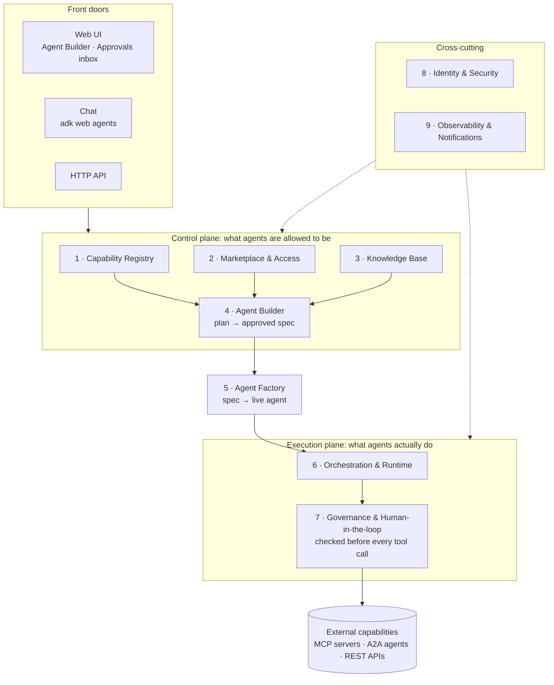

Agent-as-Spec

**Build AI agents by configuring them, not coding them: pick tools from a shared marketplace, approve the plan, and every action the agent takes runs under policy and human approval.**

Built on Google ADK · repo `agent-as-spec`

---

## The problem

- **Tools are scattered.** MCP servers, A2A agents and REST APIs live in different teams with no shared catalog and no way to request access.
- **Agents are code.** Every change means an engineer and a deploy, and nobody signs off on what the agent will actually do.
- **Agents act unchecked.** Nothing stops a risky tool call: no approvals, no rules, no audit trail.

## The flow

**1. Discover** tools in the marketplace → **2. Compose** them into a plan → **3. Approve** it as a versioned *spec* → **4. Run** it as a live agent → **5. Govern** every tool call it makes

---

## Module map

## The modules

| #   | Module                             | What it does                                                                                                                                                                                                                 | Why it matters                                                                         | Status                                     |
| --- | ---------------------------------- | ---------------------------------------------------------------------------------------------------------------------------------------------------------------------------------------------------------------------------- | -------------------------------------------------------------------------------------- | ------------------------------------------ |
| 1   | **Capability Registry**            | One catalog for every MCP server, A2A agent and REST API, with searchable tools and argument types                                                                                                                           | Builders find what already exists instead of rebuilding it                             | ✅ Built                                    |
| 2   | **Marketplace & Access**           | Publish tools as public, org or private. Other tenants request access and owners approve. Owners bring their own keys, and every call is logged                                                                              | Tools can be shared across teams without losing control                                | ✅ Built · org model pending                |
| 3   | **Knowledge Base**                 | Each tenant's documents, used to ground agents                                                                                                                                                                               | Agents answer from company knowledge, not guesses                                      | 🟡 Keyword search; semantic search next    |
| 4   | **Agent Builder** (control plane)  | Describe the agent or pick tools, edit the plan, then approve it into a **versioned spec**. The spec holds a snapshot of each tool, the instruction, the runtime settings and the policy, and is validated before it's saved | The spec is the product: reviewable, versioned, and changed without code               | ✅ Built                                    |
| 5   | **Agent Factory**                  | Compiles a spec into a live ADK agent using one of 7 patterns (single, sequential, parallel, loop, hierarchical, ReAct, plan-and-execute), with configurable callbacks                                                       | Builders choose how an agent reasons, not just which tools it has                      | ✅ Built                                    |
| 6   | **Orchestration & Runtime**        | A supervisor agent runs approved specs, and a test router mounts every spec as a sub-agent. Runs are durable and resumable, and retries never repeat a call                                                                  | Agents survive crashes and pauses, and the same action never runs twice                | ✅ Built · not yet tested on the live model |
| 7   | **Governance & Human-in-the-loop** | Before every tool call: guardrails, allow/deny/approve rules, approval before chosen steps, and a pause when confidence is low. Approvals happen in chat or in an inbox                                                      | Lets risk and compliance trust agents with real actions                                | ✅ Built · approver roles next              |
| 8   | **Identity & Security**            | Every run carries a tenant and user, and every tool call gets a short-lived delegated token                                                                                                                                  | Each call can be traced to the person who started it, and access stays least-privilege | ✅ Built                                    |
| 9   | **Observability & Notifications**  | Traces and metrics on every call, plus notifications for grant and run events                                                                                                                                                | Ops can see what agents did, and owners hear about new requests                        | 🟡 Traces built; notifications in dry-run  |

## Who uses it

| Persona             | Does                                                         | Where                                  |
| ------------------- | ------------------------------------------------------------ | -------------------------------------- |
| **Tool owner**      | Publishes capabilities and approves access requests          | Web UI → Capabilities, Access requests |
| **Agent builder**   | Composes, configures and approves specs                      | Web UI → Agent Builder                 |
| **Approver / risk** | Decides paused tool calls, seeing the reasons and confidence | Web UI → Approvals inbox, or in chat   |
| **End user**        | Chats with the agent                                         | `adk web` supervisor or spec agents    |

## Where it stands

- **Working today:** all 9 modules exist and run end to end, with 158 automated tests. A test worker provides 42 capabilities (22 MCP + 20 A2A), and the UI has been tested in a browser.
- **Next:**
  1. Validate behaviour on the live model gateway.
  2. Add approver roles, so not everyone in a tenant can approve.
  3. Add a real org model for org-only visibility.
  4. Turn on semantic search for knowledge.
  5. Send notifications for real (they're in dry-run now).
  6. Add auth to the test worker.

